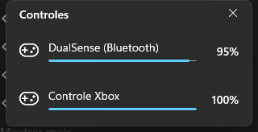

# PadBattery

Ícone na bandeja do Windows que mostra a bateria do seu controle. O ícone é a silhueta de um controle que vai se esvaziando conforme a bateria cai, no mesmo estilo monocromático dos ícones do sistema: branco no tema escuro e preto no tema claro, trocando na hora.


Da esquerda para a direita: 100%, 65%, 30%, 5%, carregando e nenhum controle conectado.

Um clique no ícone abre um painel com cada controle conectado, a porcentagem e se está carregando. O painel abre no canto perto do relógio e fecha com outro clique no ícone, com um clique fora ou no X.



## Controles suportados

| Controle | Conexão | Como a bateria é lida |
| --- | --- | --- |
| DualSense e DualSense Edge | USB e Bluetooth | Relatório de entrada HID do próprio controle, em passos de 10% |
| Xbox (One, Series) | Bluetooth e adaptador sem fio | `Windows.Gaming.Input`, com a porcentagem real |
| Outros controles XInput sem fio | Adaptador | XInput, em 4 níveis |

Não precisa de driver nem de programa extra: tudo é lido direto pelas APIs do Windows.

## Uso

- **Passar o mouse:** mostra o nome e a porcentagem de cada controle.
- **Clique esquerdo:** abre ou fecha o painel.
- **Clique direito:** menu com *Iniciar com o Windows* e *Sair*.

O estado é atualizado a cada 5 segundos.

## Requisitos

- Windows 10 1809 ou mais novo (feito para o Windows 11)
- [.NET 8 SDK](https://dotnet.microsoft.com/download/dotnet/8.0) para compilar

O runtime do Windows App SDK vai junto na pasta de saída, então não é preciso instalar nada para rodar.

## Compilar

```bash
dotnet build -c Release
```

O executável fica em `bin\Release\net8.0-windows10.0.19041.0\win-x64\PadBattery.exe`. Feche o PadBattery antes de compilar de novo, porque o executável em uso fica travado.

## Estrutura

| Arquivo | Conteúdo |
| --- | --- |
| `Program.cs` | Inicialização do WinUI 3 e instância única |
| `TrayApp.cs` | Ícone da bandeja, menu e atualização periódica |
| `PadPopup.cs` | Painel em WinUI 3 com os controles |
| `PadIcon.cs` | Desenho do ícone a partir da silhueta vetorial |
| `Controllers.cs` | Leitura da bateria do DualSense (HID), Xbox e XInput |
| `Settings.cs` | Tema da barra de tarefas e iniciar com o Windows |

## Tecnologias

C# · .NET 8 · WinUI 3 (Windows App SDK) · Windows.Gaming.Input · HID · XInput
